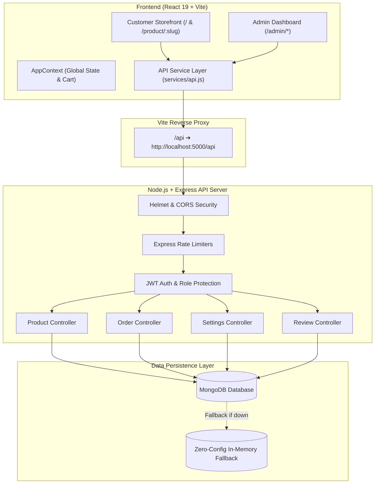

<div align="center">

# 🥭 আমওয়ালা (Ammwala)
### Enterprise Agro & Organic E-Commerce Platform

[](https://nodejs.org)
[](https://react.dev)
[](https://vitejs.dev)
[](https://tailwindcss.com)
[](https://expressjs.com)
[](https://mongodb.com)

**A high-performance, full-stack seasonal agro & organic product e-commerce ecosystem designed for high-conversion pre-bookings, flexible delivery management, and real-time storefront administration.**

[Key Features](#-key-features) • [Architecture](#-architecture) • [Getting Started](#-getting-started) • [Security & Hardening](#-security--hardening) • [Admin Credentials](#-admin-credentials) • [Deployment](#-deployment)

---

</div>

## 📖 Overview

**Ammwala** is an enterprise-grade web application built to solve the operational and conversion bottlenecks of seasonal organic food businesses in Bangladesh. Specially tailored for Rajshahi/Chapai mangoes, Sundarban raw honey, Dinajpur lychees, and cold-pressed mustard oils, it combines frictionless pre-ordering with powerful administrative controls.

---

## 🌟 Key Features

### 🛒 High-Converting Storefront
- **Clean Semantic Routing & SEO URLs:**
  - Product pages use dynamic slugs (e.g., `/product/himshagar`, `/product/amrapali`) instead of raw database IDs.
  - Smooth section scrolling without hash fragments (`#varieties`, `#about`, `#order`) in the browser URL bar.
- **Customizable Delivery Location & Free Delivery Engine:**
  - Dynamic location selector on product landing pages: `ঢাকা শহর` (Inside Dhaka) & `ঢাকার বাইরে` (Outside Dhaka).
  - **Free Delivery Override:** Individual products can be set to 100% Free Delivery from admin, displaying prominent `🎉 ফ্রি ডেলিভারি (৳০)` badges and automatically setting delivery fees to ৳0 in cart and invoice calculations.
- **Dynamic 1-Page Customer Invoice (`OrderInvoiceModal`):**
  - Instantly generates an official customer invoice with transaction ID, customer contact, delivery schedule, itemized billing, and live brand logo.
  - **Print Isolation Technology:** Enforces exact single-page print rendering via CSS `@media print` and React portals, stripping background noise and preventing multi-page overflow.
- **Interactive Product Details:**
  - Weight and package pricing toggles (e.g., 5kg, 10kg, 20kg crates).
  - Region-based harvest schedules with interactive popover calendars.
  - Full WYSIWYG specifications and storage tips.
- **Direct WhatsApp Instant Order:**
  - One-click customer ordering that pre-populates item quantities, packaging, delivery address, and calculated totals into WhatsApp chat.

---

### 🛡️ Real-Time Administrative Suite (`/admin`)

- **Interactive Storefront Settings Visualizer (`AdminSettings.jsx`):**
  1. **Header & Navigation:** Control brand display (`Logo Only`, `Logo & Text`, `Text Only`), custom call buttons, WhatsApp quick-actions, and nav links with icons.
  2. **Hero Banner & Carousel:** Multi-slide manager with custom image uploads, title typography, trust badges, and hotline numbers.
  3. **Product Section Controls:** Choose between `Grid View`, `Auto-Carousel`, or `Hide Section`, with custom card border radius, color styling, and dynamic card presets.
  4. **About & Brand Narrative:** Upload founder portrait, customize narrative description, and choose between Live Database metrics or Custom Stat numbers for orders, varieties, and customer satisfaction.
  5. **Testimonials & Review Management:** Switch between custom curated reviews (with product selection thumbnails) or live verified reviews, with auto-play speed sliders.
  6. **Dynamic 4-Column Footer & Feature Highlights:** Live color pickers, custom hex codes, social media links (`Facebook`, `Instagram`, `YouTube`, `WhatsApp`), return policy toggles, and feature highlights (Nationwide Delivery, Quality Assurance, 24/7 Support).
- **Advanced Product Management (`AdminProductForm.jsx`):**
  - Live preview with multi-device view toggles (Desktop & Mobile).
  - **Image Badge Customizer:** Place tags (e.g., `১০% ছাড়`, `সিজনাল সেরা`) in all 4 corners with drag-to-resize handles (⤡) and font size controls.
  - **Draft Auto-Saving:** Continuously background-saves changes every 5 seconds without losing edits.
  - **Scheduled Publishing:** Schedule future launch dates for seasonal crops.
- **Order Processing & CRM:**
  - Real-time order status lifecycle (`Pending` ➔ `Confirmed` ➔ `Shipped` ➔ `Delivered` ➔ `Cancelled`).
  - Search by Customer Name, Phone, or Order ID (`#BK-XXXX`).
  - Direct customer dialing and WhatsApp message generator.

---

## 🏗 Architecture



---

## 🔒 Security & Hardening

This platform incorporates industry-standard security measures across all layers:

| Layer | Security Protection | Implementation Detail |
| :--- | :--- | :--- |
| **Authentication** | JWT Bearer Token Verification | Tokens cryptographically signed with 7-day expiration; strictly validated against active database credentials. |
| **Role-Based Access** | Administrative RBAC | Administrative endpoints (`/api/products/*`, `/api/orders/*`, `/api/settings/*`) reject non-admin/unauthenticated requests with `401 Unauthorized`. |
| **Rate Limiting** | DoS & Brute-Force Prevention | Global API rate limiter (`300 requests / 15 mins`) and Strict Auth limiter (`20 login attempts / 15 mins`). |
| **Header Hardening** | Helmet HTTP Headers | Protects against XSS, Clickjacking, MIME-sniffing, and cross-origin embedding vulnerabilities. |
| **CORS Policy** | Origin Validation | Dynamically verifies incoming origins, preventing unauthorized cross-site request forgery while supporting development tunnels. |
| **Password Hashing** | Bcrypt Multi-Salt Hashing | Passwords hashed with Bcrypt (salt rounds: 12) before persistence. Passwords omitted by default from database queries (`select: false`). |
| **Input Sanitization** | Mongoose Strict Schema Validation | Data inputs sanitized against NoSQL injection; strict trimming and type casting applied on all models. |

---

## 🚀 Getting Started

### Prerequisites
- **Node.js**: `v18.0.0` or higher
- **npm**: `v9.0.0` or higher
- **MongoDB**: Local MongoDB instance or MongoDB Atlas URI *(Optional: In-memory fallback boots automatically if no database is found)*

---

### Installation

1. **Clone the repository:**
   ```bash
   git clone https://github.com/alramim07/organic-product-ecommerce-.git
   cd organic-product-ecommerce-
   ```

2. **Install backend dependencies:**
   ```bash
   cd backend
   npm install
   ```

3. **Install frontend dependencies:**
   ```bash
   cd ../frontend
   npm install
   ```

---

### Environment Setup

Create `backend/.env` in the `backend/` directory:

```env
PORT=5000
NODE_ENV=development
MONGO_URI=mongodb://127.0.0.1:27017/ammwala_db
JWT_SECRET=ammwala_enterprise_production_secret_key_2026_secured
JWT_EXPIRES_IN=7d
ADMIN_EMAIL=admin@test.com
ADMIN_PASSWORD=Test123@#
FRONTEND_URL=http://localhost:5173
```

---

### Running Development Servers

#### 1. Start Backend:
```bash
cd backend
npm run dev
# Server running at: http://localhost:5000/api
```

#### 2. Start Frontend:
```bash
cd frontend
npm run dev
# Storefront running at: http://localhost:5173
```

---

## 🔐 Admin Credentials

| Parameter | Details |
| :--- | :--- |
| **Admin Portal URL** | `http://localhost:5173/admin/login` |
| **Email** | `admin@test.com` |
| **Password** | `Test123@#` |
| **Default Role** | `superadmin` |

*(Note: Admin password can be changed securely anytime from the Admin Dashboard).*

---

## 🌐 Live Preview & Cloudflare Tunnel

To share a live, publicly accessible link with clients or team members without port forwarding:

```bash
# From the project root:
.\cloudflared.exe tunnel --url http://localhost:5173
```

Cloudflare will output a clean, secure public HTTPS URL (e.g., `https://xxxx.trycloudflare.com`) that connects directly to the storefront and admin panel with API proxying enabled.

---

## 📦 Production Build

```bash
cd frontend
npm run build
```
Static assets will be generated in `frontend/dist/`, optimized with Gzip/Brotli compression ready for deployment on Vercel, Netlify, VPS, or Nginx.

---

## 📄 License & Attribution

This project is proprietary and actively maintained for **Ammwala Agro & Organic Foods**. All rights reserved.
